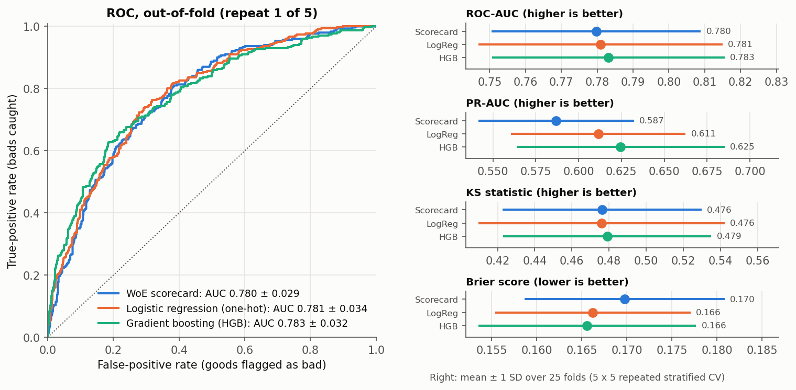
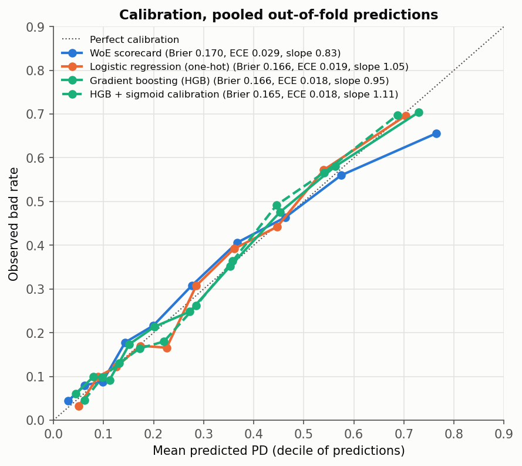
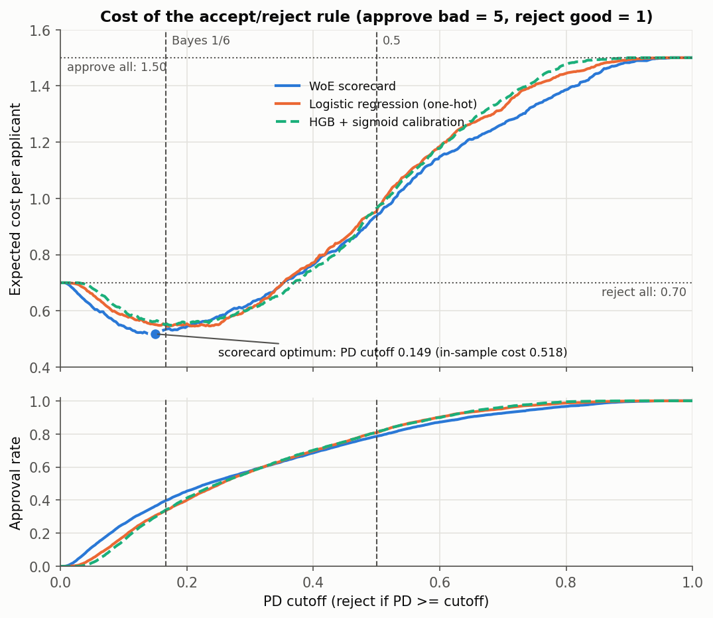
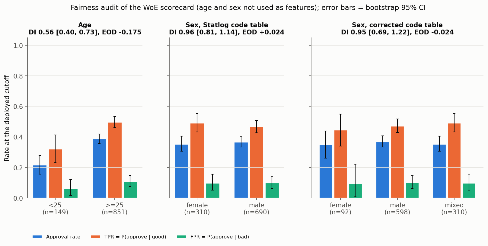

# Credit-Risk Scorecard

An end-to-end, bank-style credit-risk model: a Weight-of-Evidence scorecard built from scratch,
compared with gradient boosting, with cost-sensitive decisions, calibration, adverse-action reason
codes, a fairness audit and a FastAPI service.

[](https://github.com/faiqrasulov/credit-risk-scorecard/actions/workflows/ci.yml)

[](LICENSE)

## Key results

German Credit (1,000 applicants, 30% bad), 5 x 5 repeated stratified cross-validation. Every
number comes from `make run` (about 1.5 minutes on a laptop CPU) and is stored in
[`reports/metrics.json`](reports/metrics.json). The committed file was produced with the package
versions pinned in [`requirements.lock`](requirements.lock); on current scikit-learn the
gradient-boosting numbers change slightly.

- **The interpretable scorecard matches gradient boosting.** ROC-AUC 0.780 ± 0.029 for the WoE
  scorecard (11 features, 46 bins, additive points) vs 0.783 ± 0.032 for tuned
  HistGradientBoosting and 0.781 ± 0.034 for one-hot logistic regression. The gaps are a tenth
  of the fold-to-fold SD.
- **The cutoff matters more than the model.** With approving a bad applicant 5 times as costly
  as rejecting a good one, the default 0.5 PD cutoff costs **0.937** per applicant. That is worse
  than rejecting everyone (0.70). The cost-optimal cutoff (reject at PD >= 0.149, i.e. score
  <= 537) costs **0.536 ± 0.010** when the cutoff itself is chosen out of sample, and approves
  36% of applicants. The theoretical Bayes cutoff of 1/6 gives the same cost (0.534).
- **The scorecard is at least as cheap as the alternatives:** 0.536 vs 0.562-0.570 for the
  boosting variants and 0.567 for logistic regression. The gaps are small, the repeats reuse the
  same 1,000 applicants, and the per-repeat ordering is not stable, so this is a tie on cost,
  not a win. The scorecard's advantage is that it is interpretable at no cost in accuracy.
- **Dropping age from the model does not remove the age gap.** Applicants under 25 are approved
  at **0.56x** the rate of older applicants (95% CI 0.40-0.73), below the four-fifths screening
  line. Among applicants who repaid, 32% of the young are approved vs 50% of the rest.
- **Data-quality catch:** the Statlog code table is wrong for 8 attributes (Grömping, 2019),
  which this repo verifies against her published distributions. It changes the meaning of the
  strongest feature, and the "sex" column used in many fairness studies cannot be derived from
  this data.



## Problem & why it matters

A lender approving or declining applications faces two very different errors. An approved
applicant who defaults loses principal. A declined applicant who would have repaid loses only
the margin. The German Credit data come with a 5:1 cost matrix for exactly this reason, so
"accuracy at a 0.5 cutoff" is the wrong target.

Lending is also regulated. In the US, a declined applicant must be given the specific principal
reasons for the decision (ECOA / Regulation B adverse-action notices). The EU AI Act lists
creditworthiness scoring as a high-risk use. Models must avoid discriminating on protected
characteristics, and validators and credit officers need to understand them. That is why banks
still use points-based scorecards: every applicant's score is a sum of table lookups, and the
reasons for a decline fall out of the same table. For such models, interpretability, cost-aware
cutoffs and fairness matter as much as AUC.

This project builds that pipeline end to end and asks a practical question: how much does the
transparent scorecard give up against a modern gradient-boosting model? German Credit is small
(1,000 rows) and old (credits from 1973-1975), so it can only answer that question with wide
error bars. The uncertainty is reported everywhere instead of hidden.

## Approach

| Module | What it does | Key design decision |
|---|---|---|
| `woe.py` | **From scratch:** WoE binning + Information Value as a scikit-learn transformer | Numeric: 20 quantile pre-bins -> merge bins under 5% of rows -> pool-adjacent-violators until the bad rate is strictly monotonic (both directions tried, higher IV kept) -> merge the pair that loses least IV, down to 6 bins. Categorical: levels sorted by bad rate, rare levels merged into the closest neighbour. Laplace smoothing (0.5) keeps WoE finite; unseen levels get WoE 0. Features with IV < 0.02 are dropped. |
| `scorecard.py` | Logistic regression on WoE, scaled to points; reason codes | 600 points at 50:1 good:bad odds, PDO 20. A feature whose coefficient has the wrong sign is dropped and the model refitted, so better bins always earn more points. Reason codes = the 3 features with the most points lost against their best bin. |
| `models.py` | One-hot L2 logistic regression; HistGradientBoosting | Both tuned by inner 3-fold CV on log loss (a proper scoring rule for PDs): C for the logistic model, 12 configurations for boosting, with native categorical splits. |
| `evaluation.py` | 5 x 5 repeated stratified CV with out-of-fold PDs | Binning, IV filtering, encoding, tuning and calibration are all refitted inside each training fold (scikit-learn pipelines), so nothing sees the test fold. |
| `decision.py` | Expected cost, exact cost-optimal cutoff | Searches every distinct decision rule, not a grid. A second estimate picks the cutoff on 4/5 of the out-of-fold predictions and scores it on the other 1/5, which removes the optimism of tuning the cutoff in-sample. |
| `metrics.py` | ROC-AUC, Gini, PR-AUC, KS, Brier, ECE, calibration slope | KS is checked against `scipy.stats.ks_2samp` in the tests. |
| `fairness.py` | Approval rate, TPR, FPR by group; disparate impact; equal opportunity | Bootstrap CIs over applicants; sex derived under both the Statlog and the corrected code tables. |
| `schema.py`, `data.py` | 20-field schema, OpenML loader, corrected code table | Grömping's Table 1 is transcribed and checked against the data on every run. |
| `api.py`, `Dockerfile` | FastAPI `/health` and `/score` | Pydantic schema with every category level spelled out. The Docker build trains the model inside the image (see [Serving](#serving)). |

**Protected attributes.** `age` and `personal_status` (Statlog documents it as sex + marital
status) are protected characteristics in most lending regulation, and `foreign_worker` is a
national-origin proxy. All three are excluded from every model's features but kept for the
audit. An ablation refits the scorecard *with* them to measure what the exclusion costs and
what it changes.

**Calibration inside CV.** The tuned boosting model is wrapped in `CalibratedClassifierCV`
(sigmoid and isotonic, 5 inner folds) within each outer training fold. Calibration is evaluated
on pooled out-of-fold predictions with the Brier score, ECE (10 equal-count bins) and the slope
of a logistic recalibration (1 = ideal, < 1 = predictions too extreme).

**Correctness checks** (56 tests, about 10 s, no network): WoE/IV against a hand-computed
3-category example; monotonicity and minimum bin size on simulated risk curves; points
arithmetic (base score at base odds, +PDO doubles the odds, points sum exactly to the model
score); the cost optimiser against a known answer and brute-force search; the 1/6 Bayes cutoff
recovered on 200,000 perfectly calibrated simulated PDs; KS vs scipy; the transcribed code
table (percentages sum to 100 and imply whole counts of the 300 bads and 700 goods); the API
with FastAPI's TestClient on a model fitted to synthetic data; and an end-to-end smoke test of
the whole pipeline on synthetic data.

## Results

### Model comparison

Mean ± SD over 25 folds:

| Model | ROC-AUC | Gini | PR-AUC | KS | Brier |
|---|---:|---:|---:|---:|---:|
| **WoE scorecard (served)** | 0.780 ± 0.029 | 0.559 ± 0.058 | 0.587 ± 0.045 | 0.476 ± 0.054 | 0.170 ± 0.011 |
| Logistic regression, one-hot (C tuned) | 0.781 ± 0.034 | 0.562 ± 0.068 | 0.611 ± 0.051 | 0.476 ± 0.066 | 0.166 ± 0.011 |
| HistGradientBoosting (tuned) | 0.783 ± 0.032 | 0.566 ± 0.065 | 0.625 ± 0.061 | 0.479 ± 0.056 | 0.166 ± 0.012 |
| HGB + sigmoid calibration | 0.785 ± 0.033 | 0.570 ± 0.066 | 0.631 ± 0.059 | 0.480 ± 0.056 | 0.165 ± 0.011 |
| HGB + isotonic calibration | 0.783 ± 0.033 | 0.566 ± 0.067 | 0.627 ± 0.060 | 0.475 ± 0.061 | 0.166 ± 0.013 |
| Ablation: scorecard incl. age, sex/marital, foreign worker | 0.784 ± 0.027 | 0.568 ± 0.054 | 0.593 ± 0.043 | 0.485 ± 0.051 | 0.168 ± 0.010 |

- On ranking (ROC-AUC, Gini, KS) the three model families are indistinguishable on 1,000 rows.
- **Where the scorecard is weaker:** PR-AUC (0.587 vs 0.625) and Brier (0.170 vs 0.166). The
  boosting model ranks the riskiest applicants slightly better. The gap is under one SD, but it
  points the same way in both metrics.
- The 25 folds share data, so the SDs describe fold-to-fold variability, not the standard error
  of a difference.
- The boosting grid is interior: `max_iter = 100` won in 21 of 25 folds (50 in 3, 200 in 1).
  The logistic model chose C = 0.1 in all 25. The boosting grid was widened once, after a first
  run selected its edge (see the commit history); the scorecard's own settings were not tuned.

### Calibration



Pooled out-of-fold predictions (5,000 = 1,000 applicants x 5 repeats):

| Model | Brier | ECE | Log loss | Calibration slope |
|---|---:|---:|---:|---:|
| WoE scorecard | 0.1697 | 0.0289 | 0.5094 | 0.83 |
| Logistic regression, one-hot | 0.1662 | 0.0194 | 0.5012 | 1.05 |
| HistGradientBoosting | 0.1656 | 0.0180 | 0.5033 | 0.95 |
| HGB + sigmoid | 0.1649 | 0.0177 | 0.5000 | 1.11 |
| HGB + isotonic | 0.1664 | 0.0207 | 0.5224 | 0.83 |

Boosting tuned on log loss was already close to calibrated (slope 0.95, ECE 0.018).
Sigmoid calibration improved log loss only marginally (0.5033 -> 0.5000). **Isotonic
calibration made things worse** (log loss 0.5224): each isotonic map is fitted on only 160
held-out rows, so its step function overfits and produces over-confident PDs (slope 0.83). The
scorecard has the highest ECE (0.029) and a slope of 0.83, i.e. its PDs are somewhat too
extreme, consistent with estimating both the WoE values and the coefficients on the same
800 training rows.

### Cost-sensitive cutoff



Expected cost per applicant (approve bad = 5, reject good = 1), mean ± SD over the 5 repeats of
out-of-fold predictions. Rejecting everyone costs 0.70; approving everyone costs 1.50.

| Model | Cutoff 0.5 | Bayes cutoff 1/6 | Best cutoff, in-sample | Best cutoff, cross-validated |
|---|---:|---:|---:|---:|
| **WoE scorecard** | 0.937 ± 0.017 | 0.534 ± 0.013 | 0.510 ± 0.006 (PD 0.140) | **0.536 ± 0.010** |
| Logistic regression, one-hot | 0.953 ± 0.028 | 0.549 ± 0.014 | 0.532 ± 0.012 (PD 0.186) | 0.567 ± 0.021 |
| HistGradientBoosting | 0.914 ± 0.038 | 0.557 ± 0.017 | 0.543 ± 0.013 (PD 0.149) | 0.570 ± 0.018 |
| HGB + sigmoid | 0.965 ± 0.021 | 0.554 ± 0.018 | 0.538 ± 0.012 (PD 0.175) | 0.562 ± 0.021 |
| HGB + isotonic | 0.921 ± 0.018 | 0.557 ± 0.024 | 0.541 ± 0.017 (PD 0.160) | 0.566 ± 0.032 |

- **0.5 is the wrong cutoff.** At 0.5 the scorecard approves 78.5% of applicants and costs
  0.937. At the cost-optimal cutoff it approves about 36% and costs 0.536.
- **Tuning the cutoff buys nothing out of sample.** The in-sample optimum (0.510) is optimistic.
  Choosing the cutoff on held-out predictions gives 0.536, the same as simply using the
  decision-theoretic cutoff 1/6 = cost_reject_good / (cost_reject_good + cost_approve_bad)
  (0.534). On reasonably calibrated PDs, theory is as good as tuning.
- The served model uses the cutoff that minimises cost over all 5,000 pooled out-of-fold PDs:
  **PD >= 0.1495, i.e. score <= 537.3**.
- **The scorecard is no more expensive to operate:** its mean cross-validated cost is below tuned
  boosting, logistic regression and each calibrated boosting variant, but not in every repeat,
  and the differences are within noise for 1,000 applicants. Its approval curve
  sits above the others at low cutoffs (figure, bottom panel): it is better at isolating a large
  low-risk group. That is the region a 5:1 cost matrix cares about, and global metrics like
  PR-AUC do not measure it.
- **Why approval is so low:** the sample's 30% bad rate is an artefact of oversampling (the
  bank's true rate was about 5%). On a real applicant flow the PDs, cutoff and approval rate
  would all shift.

### Explainability

**The scorecard** ([`reports/scorecard.md`](reports/scorecard.md), CSV in `reports/scorecard.csv`),
excerpt:

| Feature | Bin (Statlog label) | Bad rate | WoE | Points | Meaning per Grömping (2019) |
|---|---|---:|---:|---:|---|
| checking_status | no checking | 11.7% | +1.171 | 74 | >= 200 DM or salary for at least 1 year |
| checking_status | >=200 | 22.2% | +0.384 | 55 | 0 <= ... < 200 DM |
| checking_status | 0<=X<200 | 39.0% | -0.399 | 37 | < 0 DM |
| checking_status | <0 | 49.3% | -0.814 | 28 | no checking account |
| duration (months) | < 9 | 10.6% | +1.243 | 74 | |
| duration (months) | >= 48 | 56.2% | -1.090 | 23 | |

**Reason codes.** `POST /score` for the example applicant in `api_schema.py` (actual output):

```json
{
  "probability_of_default": 0.432306,
  "score": 494.98,
  "decision": "reject",
  "threshold_pd": 0.149462,
  "cutoff_score": 537.29,
  "reason_codes": [
    {"feature": "checking_status", "value": "<0", "bin": "<0", "points": 27.55, "best_bin_points": 73.74, "points_lost": 46.19},
    {"feature": "duration", "value": 24.0, "bin": "[18, 36)", "points": 44.27, "best_bin_points": 73.71, "points_lost": 29.44},
    {"feature": "savings_status", "value": "<100", "bin": "<100", "points": 40.57, "best_bin_points": 63.52, "points_lost": 22.96}
  ]
}
```

Because the score is additive, these are exact attributions, not approximations.

**Permutation importance** (drop in ROC-AUC when a feature is shuffled; test folds of the first
CV repeat):

| Feature | Gradient boosting | Scorecard | IV (all data) |
|---|---:|---:|---:|
| checking_status | 0.112 ± 0.018 | 0.095 ± 0.014 | 0.659 |
| duration | 0.045 ± 0.011 | 0.031 ± 0.010 | 0.271 |
| credit_history | 0.022 ± 0.012 | 0.026 ± 0.007 | 0.289 |
| purpose | 0.021 ± 0.012 | 0.022 ± 0.013 | 0.165 |
| savings_status | 0.017 ± 0.006 | 0.016 ± 0.009 | 0.187 |
| credit_amount | 0.013 ± 0.012 | 0.009 ± 0.008 | 0.136 |
| employment | 0.010 ± 0.010 | 0.012 ± 0.006 | 0.086 |

Both models rely on the same five features in the same order: the boosting model is not finding
structure the scorecard misses. Six of the 17 candidate features have IV below 0.02 and are
dropped in at least 76% of training folds ([`reports/iv_table.md`](reports/iv_table.md)); the
final model keeps 11.

### Fairness audit



Served scorecard, out-of-fold decisions at the deployed cutoff (averaged over the 5 repeats),
95% bootstrap intervals that resample applicants with the model held fixed, so they do not include
model-fitting uncertainty. DI = approval rate of the unprivileged group / privileged group;
EOD = difference in approval rate among applicants who repaid (TPR).

| Comparison | n | Bad rate | Approval rate | TPR | DI [95% CI] | EOD [95% CI] |
|---|---|---|---|---|---:|---:|
| Age < 25 vs >= 25 | 149 / 851 | 40.9% / 28.1% | 21.7% / 38.9% | 32.3% / 49.8% | **0.56 [0.40, 0.73]** | **-0.175 [-0.274, -0.077]** |
| "Female" vs "male", Statlog codes | 310 / 690 | 35.2% / 27.7% | 35.4% / 36.7% | 49.3% / 46.9% | 0.96 [0.81, 1.14] | +0.024 [-0.048, +0.098] |
| Female vs male, corrected codes | 92 / 598 | 27.2% / 27.8% | 35.2% / 37.0% | 44.8% / 47.2% | 0.95 [0.69, 1.22] | -0.024 [-0.139, +0.086] |

- **Age: a clear, uncomfortable gap.** Age is not a feature, yet young applicants are approved
  at 0.56x the rate of older ones, and creditworthy young applicants at 32% vs 50%. Correlated
  features (short employment, renting, low savings) carry the age signal; "fairness through
  unawareness" does not work here. Part of the gap reflects a real difference in observed
  default (40.9% vs 28.1%). Whether the remainder is acceptable is a policy question, not a
  modelling one. Adding age as a feature makes it worse (DI 0.42).
- **Sex: no gap, but little evidence.** Grömping (2019) shows that Statlog's level "female:
  divorced/separated/married" actually holds non-single women *and single men*; only the 92
  applicants labelled "male: married/widowed" (really "female: single") are identifiably female.
  On that basis the DI interval spans 0.69-1.22: the data cannot rule out a sizeable gap
  either way.
- **What the exclusion buys:** the ablation scorecard that uses age, sex/marital status and
  foreign worker has the same accuracy (ROC-AUC 0.784 vs 0.780) and the same cross-validated
  cost (0.536). But it lowers the Statlog-coded "female" DI from 0.96 to 0.77, below the 0.8
  line. Under the corrected codes that penalty falls on the mixed group (single men and
  non-single women), not on women: the "sex bias" often reported for this data set is partly a
  code-table artefact.

### The wrong code table, verified

Grömping (2019) traced the data back to its source and found that the Statlog code table mixes up
the levels of 8 attributes. `codebook_check()` compares her published level-by-class
percentages with the data on every run. 16 of 17 coded fields match to within 0.005 pp; `housing`
is off by 0.14 pp (one applicant). The model is unaffected, because WoE depends only on the
codes, but the interpretation changes:

- Statlog's `checking_status = "no checking"` is the *best* bin (11.7% bad), which never made
  sense. It actually means ">= 200 DM or salary assigned for at least 1 year".
- `credit_history = "critical/other existing credit"` (17.1% bad, the famous "critical accounts
  are safe" paradox) is really "all credits at this bank paid back duly".

The API keeps the Statlog labels, since that is what every user of this data set sends. The
exported scorecard adds the corrected meaning of every bin.

## Quickstart

```bash
git clone https://github.com/faiqrasulov/credit-risk-scorecard.git
cd credit-risk-scorecard
make install   # pip install -e ".[dev]"
make run       # downloads German Credit (OpenML, cached in data/), runs every analysis,
               # writes reports/ and models/scorecard.joblib (~1.5 min, < 200 MB RAM)
make test      # 56 tests, ~10 s, no network
```

`make install` takes the newest compatible packages. To reproduce the committed `reports/`, use
`make install-locked` instead: it installs the versions pinned in
[`requirements.lock`](requirements.lock) (Python 3.12), with which `make run` regenerates every
value in `reports/metrics.json` exactly (checked on macOS arm64).

## Serving

```bash
make train     # only the served model: cutoff from repeated CV + fit on all rows (~10 s)
make serve     # uvicorn on 127.0.0.1:8000; interactive docs at /docs
curl localhost:8000/health
curl -X POST localhost:8000/score -H "Content-Type: application/json" -d '{
  "checking_status": "<0", "duration": 24, "credit_history": "existing paid",
  "purpose": "radio/tv", "credit_amount": 3500, "savings_status": "<100",
  "employment": "1<=X<4", "installment_commitment": 4, "personal_status": "male single",
  "other_parties": "none", "residence_since": 2, "property_magnitude": "car", "age": 31,
  "other_payment_plans": "none", "housing": "own", "existing_credits": 1, "job": "skilled",
  "num_dependents": 1, "own_telephone": "none", "foreign_worker": "yes"}'
```

Invalid categories, out-of-range numbers, missing or unexpected fields return HTTP 422.

**Docker.** `docker build -t credit-risk-scorecard . && docker run --rm -p 8000:8000
credit-risk-scorecard`. The build has two stages: the first installs the package into a
virtualenv and runs `credit-risk train` (downloading the data from OpenML); the runtime stage
copies only that virtualenv and the fitted artifact. Training at build time guarantees that the
pickled model is loaded by the exact scikit-learn version that produced it (joblib pickles are
not portable across versions), and no model file has to be shipped or mounted. The cost: the
build needs internet access. The image build is not part of CI; the commands it runs
(`pip install .`, `credit-risk train`, `uvicorn credit_risk.api:app`) are the ones exercised
above.

## Project structure

```
src/credit_risk/
  schema.py       20 raw fields, category levels, Grömping's corrected code table
  data.py         OpenML loader, code-table check, synthetic look-alike data for tests
  woe.py          WoE binning + IV (from scratch, scikit-learn transformer)
  scorecard.py    sign-constrained logit, points scaling, reason codes
  models.py       one-hot logistic regression, HistGradientBoosting, inner-CV tuning
  evaluation.py   repeated stratified CV, out-of-fold predictions, permutation importance
  metrics.py      AUC, Gini, PR-AUC, KS, Brier, ECE, calibration slope
  decision.py     expected cost, exact optimal cutoff, cross-validated cutoff
  fairness.py     group rates, disparate impact, equal opportunity, bootstrap CIs
  experiment.py   full reproduction -> reports/
  figures.py      the four report figures
  train.py        served model + artifact I/O
  api.py, api_schema.py   FastAPI app and pydantic schemas
  cli.py          credit-risk run | train | serve
reports/          metrics.json, figures, scorecard and IV tables (written by make run)
tests/            56 pytest tests (references: hand computation, scipy, brute force, closed form)
MODEL_CARD.md     intended use, data, metrics, fairness findings, limitations
Dockerfile        two-stage build: train, then serve
```

## Limitations & next steps

- **Small, old, oversampled data.** 1,000 credits from 1973-1975 with bads oversampled to 30%
  (true rate about 5%). The model comparison has wide error bars, and PDs, cutoffs and approval
  rates need a prior-shift correction before they mean anything for a real portfolio.
- **Accepted applicants only.** There is no reject inference, so the model never learns about
  applicants the bank turned down.
- **Stylised costs.** The 5:1 matrix is a convention. A real lender would use loss given default,
  exposure and margin per applicant, which makes the cutoff applicant-specific.
- **Age disparity is reported, not mitigated.** Next step: quantify the cost of options such as
  group-aware cutoffs or constrained training, and their legal status.
- **Monitoring is missing.** Population stability (PSI) on the score and on each binned feature
  would be the natural production addition, since the WoE bins make it cheap.
- **Statistical comparison.** A corrected resampled t-test (Nadeau & Bengio, 2003) or a larger
  data set (e.g. the Home Credit data) would put proper standard errors on model differences.

## Data & references

- **Data:** Hofmann, H. (1994). *Statlog (German Credit Data)*. UCI Machine Learning Repository,
  [doi:10.24432/C5NC77](https://doi.org/10.24432/C5NC77). License: CC BY 4.0. Loaded from OpenML
  (`data_id=31`, "credit-g") at runtime; never committed.
- Grömping, U. (2019). *South German Credit Data: Correcting a Widely Used Data Set.* Report
  4/2019, Reports in Mathematics, Physics and Chemistry, Beuth University of Applied Sciences
  Berlin.
- Siddiqi, N. (2006). *Credit Risk Scorecards: Developing and Implementing Intelligent Credit
  Scoring.* Wiley. (WoE, IV, points scaling, reason codes.)
- Thomas, L. C., Edelman, D. B., & Crook, J. N. (2002). *Credit Scoring and Its Applications.*
  SIAM.
- Ayer, M., Brunk, H. D., Ewing, G. M., Reid, W. T., & Silverman, E. (1955). An empirical
  distribution function for sampling with incomplete information. *Annals of Mathematical
  Statistics*, 26(4). (Pool-adjacent-violators.)
- Elkan, C. (2001). The foundations of cost-sensitive learning. *IJCAI*. (Bayes-optimal cutoff.)
- Platt, J. (1999). Probabilistic outputs for support vector machines. Zadrozny, B., & Elkan, C.
  (2002). Transforming classifier scores into accurate multiclass probability estimates. *KDD*.
- Hardt, M., Price, E., & Srebro, N. (2016). Equality of opportunity in supervised learning.
  *NeurIPS*. Feldman, M., et al. (2015). Certifying and removing disparate impact. *KDD*.
- Breiman, L. (2001). Random forests. *Machine Learning*, 45. (Permutation importance.)
- Nadeau, C., & Bengio, Y. (2003). Inference for the generalization error. *Machine Learning*, 52.
